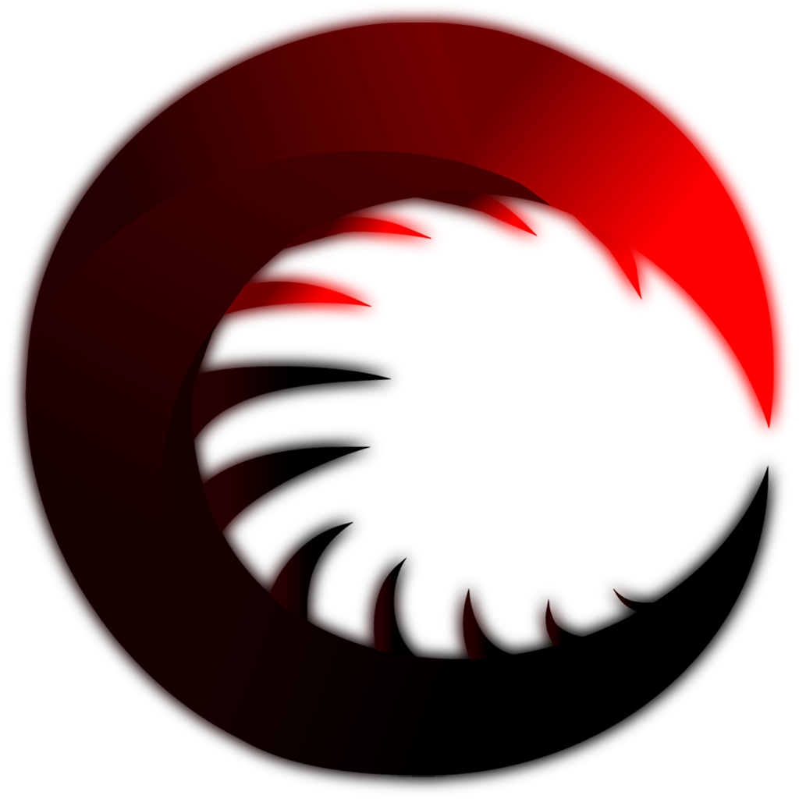

<p align="center">
  
</p>

<h1 align="center">BLADE</h1>

<p align="center">
  <strong>Твой браузер. Твои правила.</strong><br>
  Кастомный Firefox для Windows с авторским интерфейсом в тёмно-фэнтезийном стиле.
</p>

<p align="center">
  <a href="https://github.com/deni41144/blade-browser/releases/latest/download/Blade-Setup.exe"></a>
  <a href="https://github.com/deni41144/blade-browser/releases/download/v2.3.6/Blade-Patch-v2.3.6.zip"></a>
  <a href="https://github.com/deni41144/blade-browser/releases"></a>
</p>

<p align="center">
  <a href="https://github.com/deni41144/blade-browser/releases/latest"></a>
  <a href="https://github.com/deni41144/blade-browser/releases"></a>
  
  
</p>

<p align="center"><a href="#ru">Русский</a> · <a href="#en">English</a></p>

---

<a id="ru"></a>

## Что такое Blade

**Blade** — браузер для Windows на движке Firefox. Внутри остаётся Gecko; Blade добавляет собственный интерфейс, темы, оформление сайтов и настройки энергосбережения. Это не новый браузерный движок и не форк, который переписывает Firefox.

### Скачать и установить

| Что нужно | Файл | Как использовать |
|---|---|---|
| Установить Blade впервые | [Blade-Setup.exe · около 241 МиБ](https://github.com/deni41144/blade-browser/releases/latest/download/Blade-Setup.exe) | Автономный установщик со встроенным полным пакетом браузера. |
| Обновить уже установленный Blade | [Патч 2.3.6 · около 31 МиБ](https://github.com/deni41144/blade-browser/releases/download/v2.3.6/Blade-Patch-v2.3.6.zip) | Откройте **B → Обновы → Проверить сейчас** или примените патч вручную. |
| Посмотреть другие версии | [Все релизы](https://github.com/deni41144/blade-browser/releases) | В релизах лежат установщик, патч, полный архив и SHA-256. |

Установщик предназначен для Windows x64 и работает без отдельной загрузки Firefox. Сам установщик пока **не подписан сертификатом издателя**: Windows может показать предупреждение SmartScreen. Для проверки целостности скачайте `Blade-Setup.exe.sha256` рядом с EXE и сравните хеш командой:

```powershell
Get-FileHash .\Blade-Setup.exe -Algorithm SHA256
```

### Что внутри

- **Интерфейс Blade:** 10 тёмных тем, конструктор своей темы, панель B, тематические плитки и обложки сайтов.
- **Полноценная страница новой вкладки:** фон, часы с секундной точностью, погода и ярлыки. Часы браузерной панели обновляются раз в минуту.
- **Настройки памяти:** умеренный лимит контентных процессов, ограниченная история BFCache и выгрузка фоновых вкладок при давлении на память.
- **Сдержанные фоновые эффекты:** декоративные анимации окна ставятся на паузу, когда оно свёрнуто или неактивно; активный визуал сохраняется. Режим Eco и энергосбережение останавливают атмосферу новой вкладки.
- **Защита Firefox:** строгая защита от отслеживания и uBlock Origin; DNS-over-HTTPS остаётся на выбор пользователя.
- **Обновления Blade:** проверка через панель B, резервная копия перед установкой патча и восстановление при неудачном обновлении.

Версия **2.3.6** основана на Firefox **158.0**. Интерфейс и страницы сведений оформлены в Blade; `firefox.exe` остаётся официальным файлом с действительной подписью Mozilla Corporation. Изменения перечислены в [заметках выпуска](Patches/ReleaseNotes-v2.3.6.md).

### Проверка файлов релиза

У каждого архива и установщика есть `.sha256` sidecar. Скачайте файл и соответствующий SHA-256 из одного релиза, затем сравните результат `Get-FileHash` с первой строкой sidecar. Не используйте хеш из другой версии.

---

<a id="en"></a>

## English

**Blade** is a Windows browser built on Firefox. It keeps Gecko and adds the Blade interface, dark themes, website artwork and power-saving controls. It is a custom Firefox build, not a new browser engine.

### Download

| Purpose | File | Notes |
|---|---|---|
| First installation | [Blade-Setup.exe · about 241 MiB](https://github.com/deni41144/blade-browser/releases/latest/download/Blade-Setup.exe) | Offline installer with the complete browser package embedded. |
| Update Blade 2.3.6 | [Patch · about 31 MiB](https://github.com/deni41144/blade-browser/releases/download/v2.3.6/Blade-Patch-v2.3.6.zip) | Use **B → Обновы → Проверить сейчас** or apply the patch manually. |
| Other versions | [All releases](https://github.com/deni41144/blade-browser/releases) | Installer, patch, full package and SHA-256 files. |

The installer targets Windows x64. It is **not yet signed with a publisher certificate**, so Windows SmartScreen may show a warning. Verify downloads with the `.sha256` file included in the same release.

### Features

- 10 dark themes, a custom theme builder, Blade's B panel and themed website tiles.
- A new-tab page with animated artwork, a second-accurate clock, weather and shortcuts.
- Memory-conscious profile settings and background-tab unloading under memory pressure.
- Decorative browser effects pause in minimized or unfocused windows; active-window visuals remain enabled.
- Firefox Enhanced Tracking Protection, uBlock Origin and user-selectable DNS-over-HTTPS.
- In-browser update checks, a backup before patch installation and recovery after a failed update.

Blade 2.3.6 is based on Firefox 158.0. Browser pages and visible branding use Blade; the original `firefox.exe` remains signed by Mozilla Corporation. See the [release notes](Patches/ReleaseNotes-v2.3.6.md).

---

## Credits and license

- Browser, code, interface and themes — **Denis Bobliksov**.
- Widget and cover artwork — **zxvolfik**, used with permission and attribution.
- Mozilla Public License 2.0 applies to the Firefox engine. See [LICENSE.md](LICENSE.md) for Blade and artwork terms.

*Blade is an independent Firefox-based project. It is not affiliated with or endorsed by Mozilla. Firefox is a trademark of the Mozilla Foundation.*
